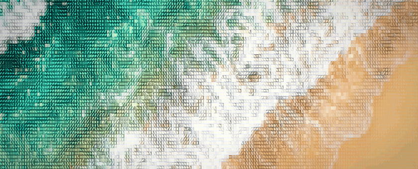
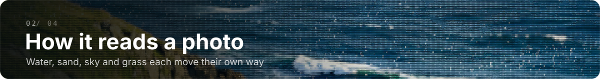
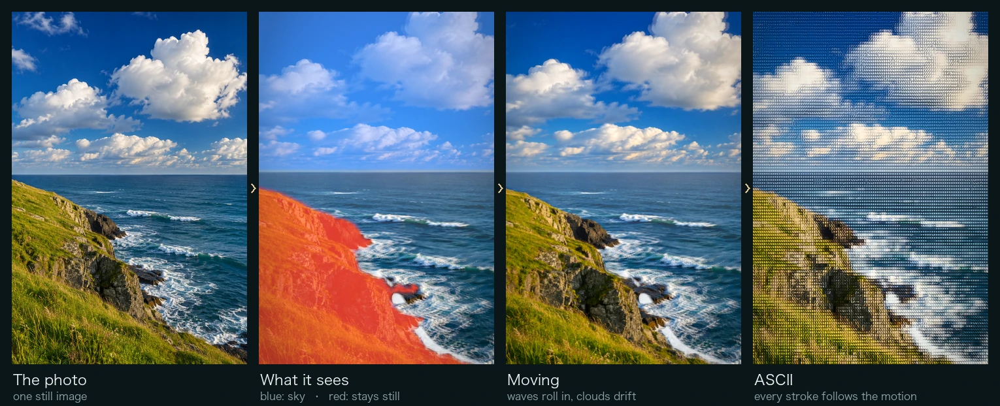
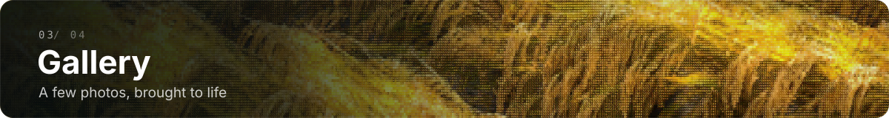
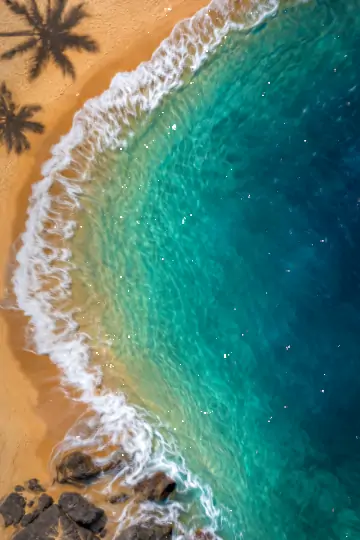
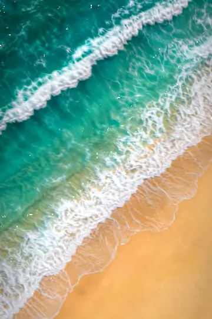
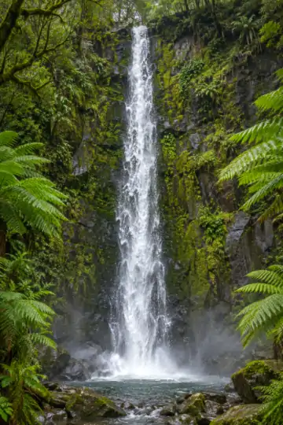
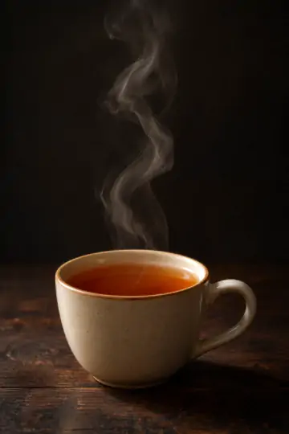
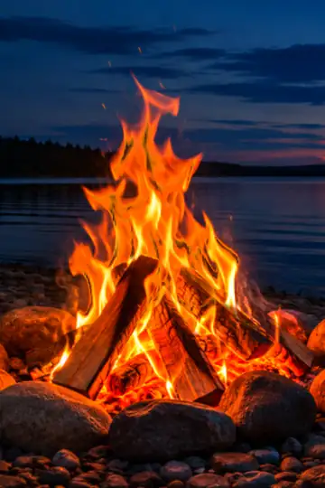
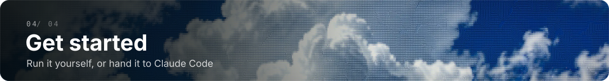

<p align="right"><b>English</b> · <a href="./README.zh-CN.md">中文</a></p>

<p align="center"></p>

<h1 align="center">asciigraph</h1>

<p align="center">Give it one photo. Get back a short loop where the sea rolls in, clouds drift and grass sways,<br>drawn as a normal video or as moving ASCII.</p>

<p align="center">
  
  
  
</p>

<br>


You pick a photo. asciigraph works out which parts should move and how, and renders a loop that you can play forever without seeing where it starts again. The banner at the top is a single beach photo.

- **Water** moves like water: waves come in from the open sea toward the shore, get smaller toward the horizon, and break white where they hit rock or sand.
- **Sky** drifts. Clouds slide slowly sideways and the far sea fades into haze.
- **Grass and fields** sway with the wind, one strand at a time.
- **Everything else stays put.** Cliffs, sand, buildings and rocks don't wobble along with the water.

You get two versions of every loop: `flow`, the photo itself in motion, and `ascii`, the same motion drawn in characters that turn with whatever is moving under them.

<br>



<p align="center"></p>

1. **It finds the sky.** Sky hangs from the top edge, is smooth, and stops at the horizon, so that's what it looks for.
2. **It finds the land.** Anything connected to sand, rock or a cliff is kept still. Grass on that land is allowed to sway.
3. **What's left is water.** It reads which way the photo's own waves already run and keeps them going in that direction, in perspective, so far waves are smaller and slower than near ones.
4. **Then it draws.** Each character's shape and angle comes from the motion right under it, which is why the ASCII looks like it's flowing instead of flickering.

<br>



<table>
  <tr>
    <td width="33%"></td>
    <td width="33%"></td>
    <td width="33%"></td>
  </tr>
  <tr>
    <td align="center"><b>Coast</b><br><sub>waves roll in, the cliff stays still</sub></td>
    <td align="center"><b>Rice field</b><br><sub>the whole field bends in the wind</sub></td>
    <td align="center"><b>Clouds</b><br><sub>nothing but sky, drifting</sub></td>
  </tr>
</table>

<p align="center"><sub>And the same thing without the ASCII, as a phone wallpaper (<code>mode=flow</code>):</sub></p>

<table>
  <tr>
    <td width="50%"></td>
    <td width="50%"></td>
  </tr>
  <tr>
    <td align="center"><b>Bay</b><br><sub>the waves follow the curve of the shore</sub></td>
    <td align="center"><b>Surf</b><br><sub>foam runs up the sand and slides back</sub></td>
  </tr>
</table>

<p align="center"><sub>Waterfalls and steam, which it moves along their own streaks (<code>scene=waterfall</code>, <code>scene=steam</code>):</sub></p>

<table>
  <tr>
    <td width="50%"></td>
    <td width="50%"></td>
  </tr>
  <tr>
    <td align="center"><b>Waterfall</b><br><sub>the water falls, the pool ripples out, the cliff stays</sub></td>
    <td align="center"><b>Steam</b><br><sub>it rises along its own curls</sub></td>
  </tr>
</table>

<p align="center"><sub>Fire, found by its colour (<code>scene=fire</code>):</sub></p>

<table>
  <tr>
    <td width="50%"></td>
    <td width="50%"></td>
  </tr>
  <tr>
    <td align="center"><b>Campfire</b><br><sub>tongues of flame rise and break off, the logs stay put</sub></td>
    <td align="center"><b>Candle</b><br><sub>a small flame, so it only wavers</sub></td>
  </tr>
</table>

<br>



### Option 1: run it yourself

You need Node.js 18 or newer.

```bash
git clone https://github.com/haoyu-haoyu/asciigraph.git
cd asciigraph
npm install
npm start
```

Open http://localhost:5177 and you'll see the beach example. To use your own photo, put it in `input/` and open:

```
http://localhost:5177/?img=input/your-photo.jpg
```

To save the videos, add `&export=ascii,flow` to the end. Keep the tab open until it says `done`; the files land in `out/`.

### Option 2: let Claude Code do it

The repo includes a `SKILL.md`. Put the repo where Claude Code looks for skills:

```bash
git clone https://github.com/haoyu-haoyu/asciigraph.git ~/.claude/skills/asciigraph
```

Then just ask, for example: *"Make this beach photo into a phone wallpaper loop."* It runs everything above, checks that the right parts are moving, and fixes the settings if they aren't.

<details>
<summary><b>Walkthrough: a phone wallpaper</b></summary>
<br>

1. Put the photo in `input/` and open `http://localhost:5177/?img=input/beach.jpg`. It sorts out water, sand and sky by itself.
2. Crop it to your screen with `&width=1179&height=2556` (that's an iPhone 15 Pro). If the wrong part ends up in frame, move it with `&focus=0.5,0.3`: across, then down, both from 0 to 1.
3. Add `&shore=show` once. The sand should turn red and the sea shouldn't. If it missed a rock or got something wrong, press `E` and paint over it (below). Take `shore=show` off again when it looks right.
4. Add `&export=ascii,flow` and wait for `done`. Both videos are in `out/`.

</details>

<details>
<summary><b>All options</b></summary>
<br>

Everything goes in the URL.

| Option | What it does |
|---|---|
| `img=input/photo.jpg` | the photo to use |
| `width=1080&height=2340` | output size; for a wallpaper, your screen size |
| `focus=0.5,0.3` | which part of the photo to keep when cropping |
| `mode=flow` | start in the plain view instead of ASCII |
| `export=ascii,flow` | save one or both versions as video |
| `scene=water` | override the guess when it's wrong (also `grass`, `sky`, and `waterfall`, `steam` or `fire`, which it never guesses) |
| `amp=0.6` | less motion; `amp=1.3` for more |
| `speed=1` | how fast the waves run (water); for clouds, `clouds=1` |
| `sky=show` | tint what it thinks is sky in blue; `sky=off` to ignore it (over water it then moves with the sea) |
| `shore=show` | tint what it's keeping still in red |
| `marks=input/photo-marks.png` | your own corrections, painted with `E` (saved and added for you) |
| `haze=0` | no haze on the horizon |

In the page, `M` switches between ASCII and the plain view, space pauses, and `E` opens the brush.

</details>

<details>
<summary><b>When it looks wrong</b></summary>
<br>

- **Something moves that shouldn't, or the other way round.** Press `E` and paint it: `1` is keep still (red), `2` is let it move (green), `3` erases, `[` `]` or the mouse wheel change the brush size. `Enter` saves them to `input/` and reloads with them, so exports use them too. `Esc` cancels.
- **The sky looks off.** Look with `sky=show`, or turn it off with `sky=off`.
- **Too calm or too busy.** Try `amp=0.6` or `amp=1.3`.

It tells water, land and sky apart by colour and texture alone. That's fine for most sea and beach photos. It can get a white building against a pale sky, or blue glass towers, wrong. When it does, paint over it with `E`.

</details>

<details>
<summary><b>What's in the repo</b></summary>
<br>

| Path | |
|---|---|
| `src/sky.js` | finds the sky and the horizon |
| `src/shore.js` | finds the land to keep still, and the grass on it |
| `src/water.js` | the water, the waves breaking and the drifting clouds |
| `src/field.js` | the swaying strands for grass and fields |
| `src/post.js` | turns a frame into ASCII |
| `src/editor.js`, `src/marks.js` | the `E` brush, and how painted marks override what it found |
| `server.mjs` | the local server; also writes the exported videos |
| `npm run check` | checks that an exported loop has no visible jump |

</details>

<br>

## License

MIT
