<p align="right"><a href="./README.md">English</a> · <b>中文</b></p>

<p align="center">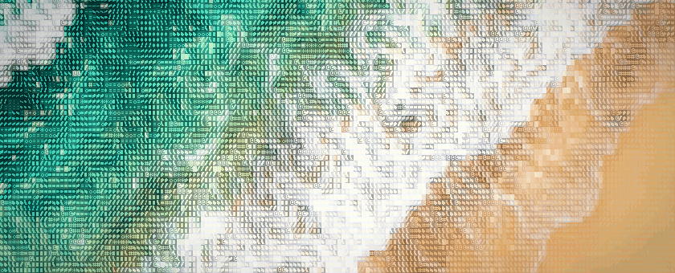</p>

<h1 align="center">asciigraph</h1>

<p align="center">给它一张照片，还你一段小循环：海浪往岸上涌，云在飘，草在摆。<br>可以是普通视频，也可以是会动的 ASCII 字符画。</p>

<p align="center">
  
  
  
</p>

<br>

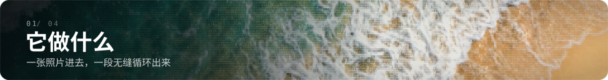

你选一张照片，asciigraph 会判断哪些地方该动、怎么动，然后渲染出一段可以一直循环播放、看不出从哪里重新开始的视频。最上面的横幅就是一张海滩照片做的。

- **水**像水一样动：浪从远海往岸边推，越靠近地平线越小，打到礁石和沙滩上会翻出白浪。
- **天空**在飘：云慢慢往一边移，远处的海面隐进薄雾里。
- **草和田野**跟着风摆，一根一根地动。
- **其他的都不动**：悬崖、沙滩、房子、礁石不会跟着海水一起晃。

每段循环都有两个版本：`flow` 是照片本身动起来，`ascii` 是同样的动作用字符画出来，每个字符都会跟着它下面的东西转方向。

<br>

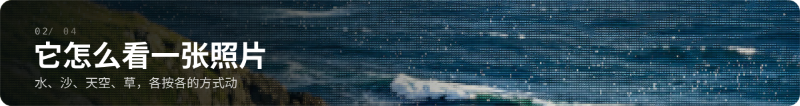

<p align="center">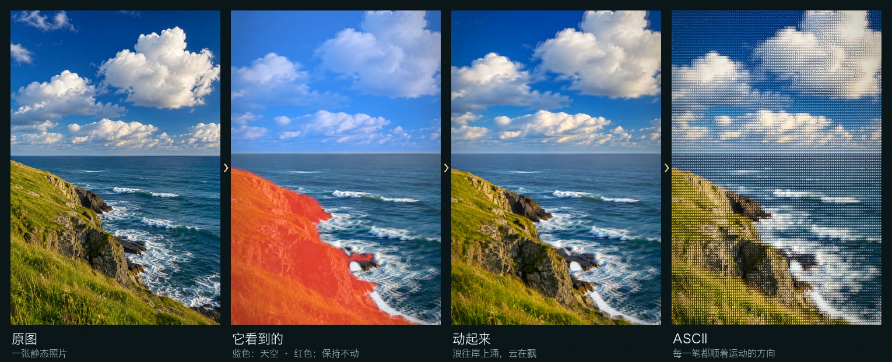</p>

1. **先找天空。** 天空从画面顶上垂下来，颜色平滑，到地平线为止，它就按这个去找。
2. **再找陆地。** 和沙滩、礁石、悬崖连在一起的部分都保持不动，陆地上的草可以摆。
3. **剩下的是水。** 它会看照片里原本的浪往哪个方向走，然后顺着这个方向、按透视继续推，所以远处的浪比近处的小，也更慢。
4. **最后画出来。** 每个字符的形状和角度都取自它下面那一点的运动，所以 ASCII 看起来是在流动，而不是在闪。

<br>

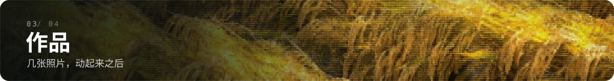

<table>
  <tr>
    <td width="33%">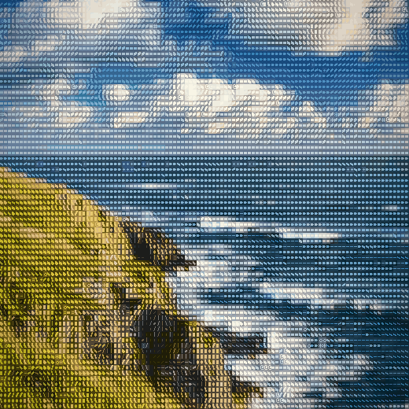</td>
    <td width="33%">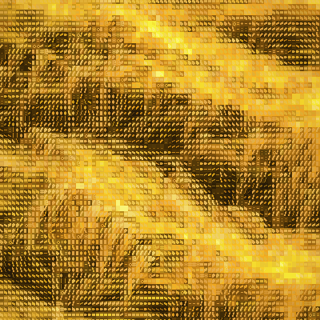</td>
    <td width="33%">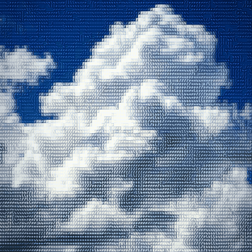</td>
  </tr>
  <tr>
    <td align="center"><b>海岸</b><br><sub>浪往里涌，悬崖不动</sub></td>
    <td align="center"><b>稻田</b><br><sub>整片田被风吹弯</sub></td>
    <td align="center"><b>云</b><br><sub>只有天空，慢慢飘</sub></td>
  </tr>
</table>

<p align="center"><sub>不要 ASCII，直接当手机壁纸也行（<code>mode=flow</code>）：</sub></p>

<table>
  <tr>
    <td width="50%">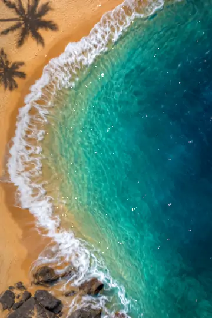</td>
    <td width="50%">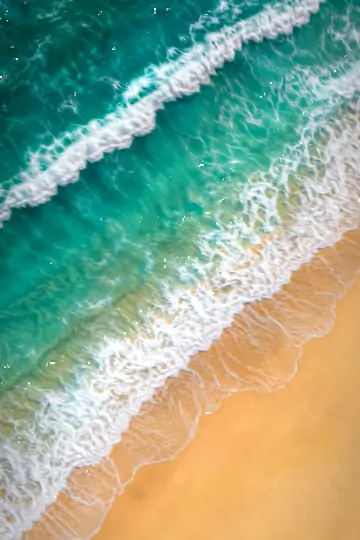</td>
  </tr>
  <tr>
    <td align="center"><b>海湾</b><br><sub>浪顺着岸线的弧度涌进来</sub></td>
    <td align="center"><b>浪花</b><br><sub>白沫冲上沙滩，再慢慢退回去</sub></td>
  </tr>
</table>

<p align="center"><sub>瀑布和蒸汽，沿着它们自己的纹理动（<code>scene=waterfall</code>、<code>scene=steam</code>）：</sub></p>

<table>
  <tr>
    <td width="50%">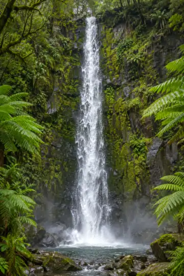</td>
    <td width="50%"></td>
  </tr>
  <tr>
    <td align="center"><b>瀑布</b><br><sub>水往下落，水池的波纹向外扩散，石壁不动</sub></td>
    <td align="center"><b>蒸汽</b><br><sub>顺着自己的弯曲往上升</sub></td>
  </tr>
</table>

<p align="center"><sub>火焰，按颜色找出来（<code>scene=fire</code>）：</sub></p>

<table>
  <tr>
    <td width="50%"></td>
    <td width="50%"></td>
  </tr>
  <tr>
    <td align="center"><b>篝火</b><br><sub>火舌往上窜、断开，木柴不动</sub></td>
    <td align="center"><b>蜡烛</b><br><sub>火苗小，只轻轻摇</sub></td>
  </tr>
</table>

<p align="center"><sub>夜里的星星和灯光（<code>scene=twinkle</code>）：</sub></p>

<table>
  <tr>
    <td width="50%">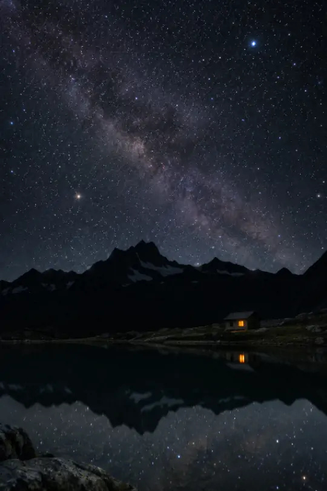</td>
    <td width="50%">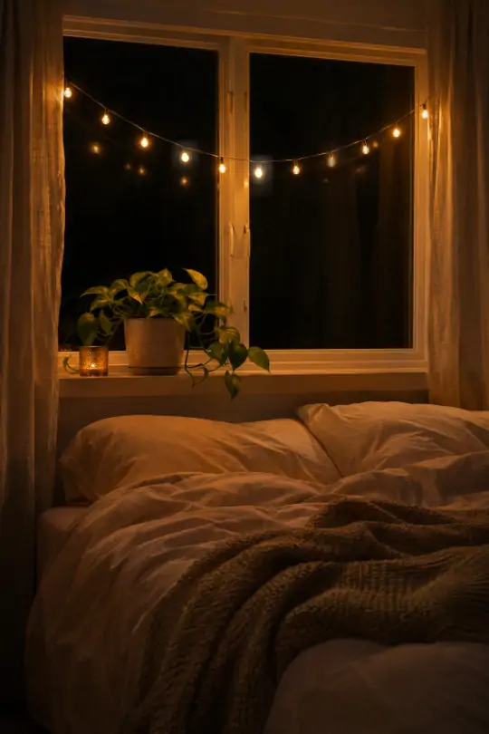</td>
  </tr>
  <tr>
    <td align="center"><b>星空</b><br><sub>越亮的星闪得越厉害，暗的只微微闪</sub></td>
    <td align="center"><b>串灯</b><br><sub>每颗灯泡各闪各的，房间不动</sub></td>
  </tr>
</table>

<br>

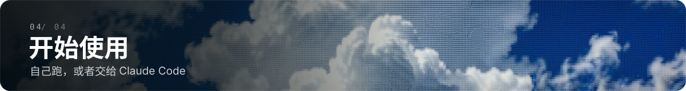

### 方式一：自己跑

需要 Node.js 22.12 以上。

```bash
git clone https://github.com/haoyu-haoyu/asciigraph.git
cd asciigraph
npm install
npm start
```

最快的用法是打开 http://localhost:5177/demo.html：把照片拖进去，选好场景和尺寸，就能下载 MP4。全程都在浏览器里完成，照片不会上传，所以这个页面也可以直接当静态网页发布，比如放到 GitHub Pages 上。

打开 http://localhost:5177 是带全部参数的完整页面，会看到海滩的例子。想用自己的照片，就放进 `input/`，然后打开：

```
http://localhost:5177/?img=input/your-photo.jpg
```

想保存视频，就在网址后面加 `&export=ascii,flow`。页面别关，等它显示 `done`，文件在 `out/` 里。

### 也可以用命令行

它会在后台调用你电脑上已有的 Chrome（或 Edge），不弹窗口：

```bash
node bin/asciigraph.mjs photo.jpg --size iphone --mode both --sound
```

其他选项用 `node bin/asciigraph.mjs --help` 查看。网址里的任何参数都可以用 `--set` 传，比如 `--set wind=30`。

### 方式二：交给 Claude Code

仓库里带了一份 `SKILL.md`，可以作为技能装进 Claude Code、Codex、Cursor 等支持技能的 AI 工具：

```bash
npx skills add haoyu-haoyu/asciigraph
```

只用 Claude Code 的话，也可以直接克隆到它找技能的地方：

```bash
git clone https://github.com/haoyu-haoyu/asciigraph.git ~/.claude/skills/asciigraph
```

然后直接说，比如：*"把这张海滩照片做成手机动态壁纸。"* 上面这些步骤它都会跑一遍，检查该动的地方有没有动对，不对就自己调参数。

<details>
<summary><b>例子：做一张手机壁纸</b></summary>
<br>

1. 把照片放进 `input/`，打开 `http://localhost:5177/?img=input/beach.jpg`。水、沙滩、天空它会自己分出来。
2. 按屏幕裁剪：加上 `&size=android`（还有 `iphone`、`mac`、`1080p`、`4k` 等；其他屏幕就写 `&width=1080&height=2340`）。如果框到的不是你想要的部分，用 `&focus=0.5,0.3` 挪一下，前一个是左右，后一个是上下，都在 0 到 1 之间。
3. 加一次 `&shore=show`：沙滩应该变红，海不应该变红。如果漏掉了礁石或者认错了，按 `E` 直接涂一下（见下面）。没问题就把 `shore=show` 去掉。
4. 加上 `&export=ascii,flow`，等它显示 `done`，两段视频就在 `out/` 里了。
5. 把 MP4 设成壁纸：Windows 用 Wallpaper Engine 或 Lively Wallpaper；安卓用视频壁纸 App（三星锁屏可以直接设，最长 15 秒）；Mac 用视频壁纸 App。iPhone 不能把视频设成循环播放的壁纸，但可以用实况照片，手机亮屏时会动一下。在 Mac 上运行 `node bin/asciigraph.mjs live photo.jpg` 就能生成。把生成的两个文件一起隔空投送到手机，再到"设置 → 墙纸"里选它。

</details>

<details>
<summary><b>全部参数</b></summary>
<br>

都写在网址里。

| 参数 | 作用 |
|---|---|
| `img=input/photo.jpg` | 用哪张照片 |
| `size=android` | 按设备选壁纸尺寸：`iphone`、`iphone-max`、`android`、`ipad`、`mac`、`1080p`、`1440p`、`4k` |
| `width=1080&height=2340` | 输出尺寸，做壁纸就填屏幕分辨率 |
| `focus=0.5,0.3` | 裁剪时保留照片的哪一部分 |
| `mode=flow` | 一打开就是普通画面，不是 ASCII |
| `ink=green`、`chars=braille`、`cell=2` | ASCII 的样子：单一荧光色（`green`、`amber`、`white`）或白底黑字 `paper`；字符可选经典 `classic`、明暗方块 `blocks`、盲文点阵 `braille`，或自己的字符（`charset= .:-=+*#@`）；字符放大；`bg=plain` 去掉字符背后的底光 |
| `export=ascii,flow` | 把其中一个或两个版本存成视频 |
| `scene=water` | 它认错照片类型时手动指定（还有 `grass`、`sky`，以及它不会自己选的 `waterfall` 瀑布、`steam` 蒸汽、`fire` 火焰、`twinkle` 夜里闪烁的星星和灯光） |
| `amp=0.6` | 动得少一点；`amp=1.3` 动得多一点 |
| `speed=1` | 海浪的速度（水）；云的速度用 `clouds=1` |
| `sky=show` | 用蓝色标出它认为是天空的地方；`sky=off` 不再单独处理天空（有海时天空会跟着海一起动） |
| `shore=show` | 用红色标出它让哪些地方保持不动 |
| `marks=input/photo-marks.png` | 你自己涂的修正，按 `E` 涂完会自动保存并加上 |
| `haze=0` | 地平线上不加雾 |
| `sound=on` | 导出时带上场景自己的声音：海浪、风、瀑布的轰鸣、篝火噼啪声、夜里的虫鸣 |

在页面里按 `M` 切换 ASCII 和普通画面，空格暂停，`S` 播放声音，`E` 打开画笔。

</details>

<details>
<summary><b>效果不对怎么办</b></summary>
<br>

- **不该动的动了，或者该动的没动。** 按 `E` 直接涂：`1` 是保持不动（红色），`2` 是让它动（绿色），`3` 是橡皮，`[` `]` 或滚轮调画笔大小。按 `Enter` 保存，标记会存进 `input/` 并自动重新加载，导出时也会用上。`Esc` 取消。
- **天空不对。** 用 `sky=show` 看一下，或者用 `sky=off` 关掉。
- **太平静或太乱。** 试试 `amp=0.6` 或 `amp=1.3`。

它只靠颜色和纹理来分水、陆地和天空。大部分海边照片没问题，但浅色天空前的白楼、蓝玻璃大楼这类可能会认错。认错了就按 `E` 涂掉。

</details>

<details>
<summary><b>放进网页、终端或 AI 工具里</b></summary>
<br>

**放进你自己的网页**，照片可以直接在页面里实时动起来，不需要视频文件：

```html
<script type="importmap">{ "imports": { "three": "https://cdn.jsdelivr.net/npm/three@0.169.0/build/three.module.js" } }</script>
<script type="module" src="https://cdn.jsdelivr.net/gh/haoyu-haoyu/asciigraph@main/src/element.js"></script>
<living-photo src="beach.jpg" mode="flow" style="height: 400px"></living-photo>
```

支持 `mode`、`scene` 这两个属性，其他参数写在 `options` 里（`options="wind=30&speed=0.8"`）。滚出屏幕时会暂停；访客如果开了"减少动态效果"，它就保持静止。`embed.html` 是一个现成的例子。

**在终端里**用彩色字符播放：

```bash
node bin/asciigraph.mjs play photo.jpg            # 在当前终端播放，Ctrl-C 退出
node bin/asciigraph.mjs stream photo.jpg          # 然后在别的终端运行：curl http://localhost:7777
```

**在 Claude Desktop、Cursor 等支持 MCP 的工具里**，作为 `animate_photo` 工具调用：

```bash
claude mcp add asciigraph -- node /path/to/asciigraph/bin/asciigraph.mjs mcp
```

</details>

<details>
<summary><b>仓库里有什么</b></summary>
<br>

| 路径 | |
|---|---|
| `src/sky.js` | 找天空和地平线 |
| `src/shore.js` | 找要保持不动的陆地，以及上面的草 |
| `src/water.js` | 水、浪花拍岸、飘动的云 |
| `src/field.js` | 草和田野里摆动的草叶 |
| `src/post.js` | 把画面变成 ASCII |
| `src/sound.js` | 每个场景的声音 |
| `src/living.js` | 生成一张会动的照片；完整页面、试用页和 `<living-photo>` 都用它 |
| `demo.html`、`src/demo.js`、`src/encode.js` | 拖照片进去就能用的试用页，MP4 直接在浏览器里生成 |
| `src/element.js` | 可以放进任何网页的 `<living-photo>` |
| `bin/asciigraph.mjs` | 命令行：导出视频，以及 `play`、`stream`、`live`、`mcp` |
| `npm run batch` | 跑一遍 `tests/photos.json` 里的照片，报告每张的结果 |
| `src/editor.js`、`src/marks.js` | `E` 画笔，以及涂的标记怎么覆盖自动识别 |
| `server.mjs` | 本地服务器，也负责写出导出的视频 |
| `npm run check` | 检查导出的循环首尾有没有跳一下 |

</details>

<br>

## 许可证

MIT
